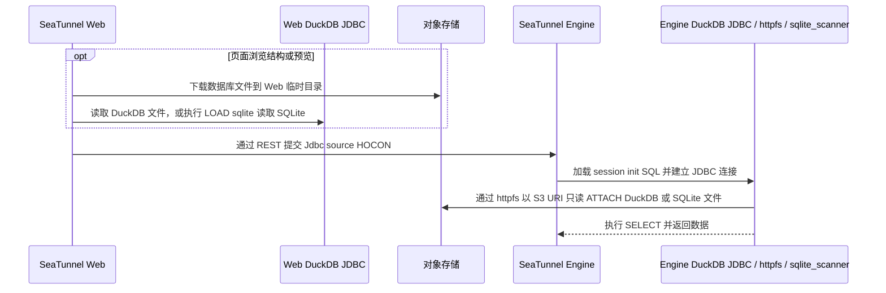

# DuckDB / SQLite 文件导入设计：Web 与 SeaTunnel Engine 解耦

## 目标

DuckDB 和 SQLite 文件作为文件资源存放在对象存储中。SeaTunnel Web 负责文件管理、表结构浏览和生成任务配置；SeaTunnel Engine 负责执行查询并读取对象存储中的文件。两端通过 SeaTunnel REST 提交的 JDBC 配置协作，不依赖 Web 与 Engine 之间的共享目录。

## 职责边界

| 环节 | SeaTunnel Web | SeaTunnel Engine |
| --- | --- | --- |
| 文件管理 | 保存文件资源元数据和对象存储引用 | 不访问 Web 的本地文件目录 |
| 表结构浏览 | 下载对象到 Web 自己的临时目录，用 Web classpath 中的 DuckDB JDBC 驱动读取；SQLite 通过 Web 运行平台匹配的 DuckDB SQLite 扩展只读挂载（SQL 使用 `LOAD sqlite`，扩展文件名为 `sqlite_scanner`）；受文件大小和并发上限约束，读取后清理临时副本 | 不参与页面的结构浏览请求 |
| 任务配置 | 将文件资源解析为对象存储 URI、查询和 JDBC source HOCON | 接收标准 `Jdbc` source 配置 |
| 任务执行 | 通过 Engine REST 提交配置 | 使用 JDBC connector、DuckDB JDBC 驱动、`httpfs` 和对应数据库扩展只读读取对象存储中的文件 |

## 执行流程

结构浏览与任务执行是两条独立路径：结构浏览由 Web 下载短期临时副本；实际任务由 Engine 通过 `httpfs` 访问对象存储，并在 SQLite 场景使用 DuckDB SQLite 扩展，不依赖 Web 临时副本。

## 解耦实现

1. **复用 JDBC connector。** Web 将数据库文件源生成为 `connector = "Jdbc"`、`driver = "org.duckdb.DuckDBDriver"` 和 `url = "jdbc:duckdb:"`。Engine 使用自己的 `connector-jdbc` 插件和 classpath 中的 DuckDB JDBC 驱动。Web 不传递驱动 JAR 的绝对路径，也不要求 Engine 读取 Web 的驱动目录。
2. **用 HOCON 传递连接初始化逻辑。** Web 将初始化 SQL 放在 `properties` 的 `duckdb.session_init_sql` 字符串属性中。这个带点号的属性名必须作为字面 key 保留，构建 `properties` 时使用 `ConfigValueFactory.fromMap`，避免被 HOCON 解析成嵌套对象。
3. **在 Engine 本地适配 JDBC 的文件要求。** Engine 的 DuckDB JDBC dialect 读取 `duckdb.session_init_sql`，在 Engine 自己的临时目录生成 `session_init_sql_file`，通过 JDBC URL 交给驱动；连接建立后清理该临时文件。Web 与 Engine 不需要共同挂载这个文件。
4. **让 Engine 直接读对象存储。** 初始化 SQL 在 Engine 侧加载 `httpfs`、创建当前任务的 S3 secret，并对对象存储 URI 执行只读 `ATTACH`。SQLite 使用 `LOAD sqlite` 和 `TYPE sqlite`；对象 URI 和凭证随 JDBC `properties` 一起经 REST 提交，不引用 Web 或 Engine 共享目录。
5. **分别安装 Web 与 Engine 运行依赖。** SQLite 远程只读 attach 要求 DuckDB SQLite 扩展 1.5.5 或更高版本。本项目将 JDBC 驱动固定为 `1.5.6.0`，匹配的扩展目录版本为 `v1.5.6`。每个 Engine 节点要安装同版本 JDBC JAR、`httpfs` 和 SQLite 扩展；Web API 预览只需要自己的 `sqlite_scanner`。`tools/seatunnel/package-duckdb-runtime.py --target engine --platform linux_arm64 --output <Engine包路径>` 与 `tools/seatunnel/install-duckdb-runtime.sh` 生成、安装 Engine 包；`--target web --platform <Web平台> --output <Web包路径>` 与 `tools/seatunnel/install-duckdb-web-runtime.sh` 为 Web API 生成、安装独立扩展包（支持 `linux_amd64` 和 `linux_arm64`）。Web 和 Engine 不能共用不匹配平台的扩展目录。`SEATUNNEL_WEB_DUCKDB_EXTENSION_DIR` 只把 Engine 内扩展目录路径写入任务 SQL；Web 不读取或挂载该目录。所有 Engine 节点应有相同的安装布局。

运行包只包含 DuckDB JDBC 和扩展，不替换 Engine 的 JDBC connector。当前 SeaTunnel 3.0.0 Engine 运行包使用的定制 `connector-jdbc` 需包含 `DuckDbJdbcConnectionProvider` 和 `DuckDbSessionInitSql`：它读取字面属性 `duckdb.session_init_sql`，在 Engine 临时目录生成仅本地使用的 SQL 文件，并通过 JDBC URL 的 `session_init_sql_file` 选项启动 DuckDB。普通上游 JDBC connector 若不实现这个属性消费者，不能只靠 Web 配置兼容；部署时必须保留已验证的 Engine connector 实现。

元数据查询也走这个适配链路。SeaTunnel 3.0.0 的 `JdbcSource` 构造阶段会调用 `JdbcCatalogUtils.getTables`；定制 `DuckDBCatalog` 和 `DuckDbJdbcConnectionProvider` 在该次连接中消费初始化 SQL。因此它会先加载扩展、创建 S3 secret、远程只读 attach，再检查表元数据，之后 source 才执行数据查询。验证时必须覆盖 source 创建的 `getTables` 阶段，不能只单测最终 `SELECT`。

## 交互契约与运维约束

- Web 与 Engine 之间的契约是 SeaTunnel 3.0.0 JDBC 配置及 `duckdb.session_init_sql` 属性。调整属性名、初始化 SQL 格式或 DuckDB JDBC 行为时，需同时验证 Web 配置生成和 Engine JDBC dialect。
- Engine 需提供带有上述 DuckDB session-init 消费实现的 SeaTunnel 3.0.0 `connector-jdbc`，以及 DuckDB JDBC `1.5.6.0` 和 `v1.5.6/<platform>` 下的配套扩展。SQLite 扩展文件为 `sqlite_scanner.duckdb_extension`，SQL 加载名为 `sqlite`。JDBC JAR 与扩展要单独安装到每个 Engine 节点；Web 不上传它们，也不要求两端共用文件夹。
- `duckdb.session_init_sql` 含有对象存储访问凭据。不要将完整初始化 SQL 或展开后的任务配置写入普通日志；Engine 临时文件应保持仅 Engine 进程可读并及时清理。
- 更新 Engine 驱动时，先停止 Engine，再在每个节点用相同的 `duckdb_jdbc-1.5.6.0.jar` 和 `v1.5.6/<platform>` 扩展目录替换旧版本，之后再启动并验证。安装脚本先在目标文件系统暂存并校验全部新文件，再把旧 JAR 和目标扩展复制到 Engine `lib` classpath 外的备份目录并校验，然后才切换文件；任一步切换失败会移除本次已安装文件并自动恢复旧文件，保留备份副本。若自动恢复也失败，脚本会保留事务目录和备份目录以供手工恢复，此时不要启动 Engine。安装脚本只修改用户显式传入的目录，不会部署或重启 Engine。
- Web 侧的 DuckDB / SQLite 临时副本仅用于结构浏览和预览，设置大小与并发限制，并在请求结束后删除。SQLite 预览的 `LOAD sqlite` 会从 DuckDB 的扩展目录载入与 Web JDBC 同版本、同平台的扩展；离线 Web API 必须使用 `--target web` 包将 `sqlite_scanner` 安装到 `SEATUNNEL_WEB_DUCKDB_CATALOG_EXTENSION_DIR` 指向的 Web 本地扩展目录，不能复用只有 Engine ARM64 构建的扩展。临时副本不是 Engine 任务的输入路径。
