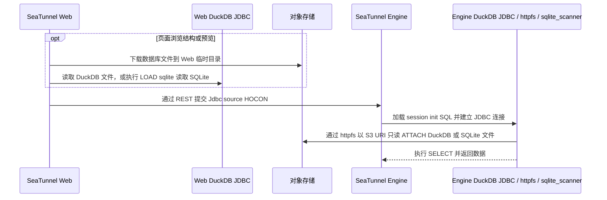

# DuckDB / SQLite 文件导入设计：Web 与 SeaTunnel Engine 解耦

## 目标

DuckDB 和 SQLite 文件作为文件资源存放在对象存储中。SeaTunnel Web 负责文件管理、表结构浏览和生成任务配置；SeaTunnel Engine 负责执行查询并读取对象存储中的文件。两端通过 SeaTunnel REST 提交的 JDBC 配置协作，不依赖 Web 与 Engine 之间的共享目录。

## 职责边界

| 环节 | SeaTunnel Web | SeaTunnel Engine |
| --- | --- | --- |
| 文件管理 | 保存文件资源元数据和对象存储引用 | 不访问 Web 的本地文件目录 |
| 表结构浏览 | 下载对象到 Web 自己的临时目录，用 Web classpath 中的 DuckDB JDBC 驱动读取；SQLite 通过 DuckDB SQLite 扩展只读挂载（SQL 使用 `LOAD sqlite`，扩展文件名为 `sqlite_scanner`）；受文件大小和并发上限约束，读取后清理临时副本 | 不参与页面的结构浏览请求 |
| 任务配置 | 将文件资源解析为对象存储 URI、查询和 JDBC source HOCON | 接收标准 `Jdbc` source 配置 |
| 任务执行 | 通过 Engine REST 提交配置 | 使用 JDBC connector、DuckDB JDBC 驱动、`httpfs` 和对应数据库扩展只读读取对象存储中的文件 |

## 执行流程

结构浏览与任务执行是两条独立路径：结构浏览由 Web 下载短期临时副本；实际任务由 Engine 通过 `httpfs` 访问对象存储，并在 SQLite 场景使用 DuckDB SQLite 扩展，不依赖 Web 临时副本。

## 解耦实现

1. **复用 JDBC connector。** Web 将数据库文件源生成为 `connector = "Jdbc"`、`driver = "org.duckdb.DuckDBDriver"` 和 `url = "jdbc:duckdb:"`。Engine 使用自己的 `connector-jdbc` 插件和 classpath 中的 DuckDB JDBC 驱动。Web 不传递驱动 JAR 的绝对路径，也不要求 Engine 读取 Web 的驱动目录。
2. **用 HOCON 传递连接初始化逻辑。** Web 将初始化 SQL 放在 `properties` 的 `duckdb.session_init_sql` 字符串属性中。这个带点号的属性名必须作为字面 key 保留，构建 `properties` 时使用 `ConfigValueFactory.fromMap`，避免被 HOCON 解析成嵌套对象。
3. **在 Engine 本地适配 JDBC 的文件要求。** Engine 的 DuckDB JDBC dialect 读取 `duckdb.session_init_sql`，在 Engine 自己的临时目录生成 `session_init_sql_file`，通过 JDBC URL 交给驱动；连接建立后清理该临时文件。Web 与 Engine 不需要共同挂载这个文件。
4. **让 Engine 直接读对象存储。** 初始化 SQL 在 Engine 侧加载 `httpfs`、创建 S3 secret，并对对象存储 URI 执行只读 `ATTACH`。SQLite 使用 `LOAD sqlite` 和 `TYPE sqlite`；查询使用 DuckDB 中的 schema 和表名，不先把源文件放进 Web 或 Engine 的共享目录。
5. **把运行依赖留在执行端。** Engine 节点需安装与 DuckDB JDBC 版本及节点平台匹配的 `httpfs` 扩展；读取 SQLite 时还需 SQLite 扩展（扩展文件名为 `sqlite_scanner`）。`SEATUNNEL_WEB_DUCKDB_EXTENSION_DIR` 只让 Web 把 Engine 的扩展目录写入初始化 SQL；该路径由 Engine 解释，Web 不读取或挂载该目录。所有 Engine 节点都应有相同的扩展安装布局。

## 交互契约与运维约束

- Web 与 Engine 之间的契约是 SeaTunnel 3.0.0 JDBC 配置及 `duckdb.session_init_sql` 属性。调整属性名、初始化 SQL 格式或 DuckDB JDBC 行为时，需同时验证 Web 配置生成和 Engine JDBC dialect。
- Engine 需提供 `connector-jdbc`、DuckDB JDBC 驱动和版本/平台匹配的 `httpfs` 扩展；读取 SQLite 时还需匹配的 SQLite 扩展（扩展文件名为 `sqlite_scanner`，SQL 加载名为 `sqlite`）。这些依赖由 Engine 部署负责，不由 Web 上传或分发。
- `duckdb.session_init_sql` 含有对象存储访问凭据。不要将完整初始化 SQL 或展开后的任务配置写入普通日志；Engine 临时文件应保持仅 Engine 进程可读并及时清理。
- Web 侧的 DuckDB / SQLite 临时副本仅用于结构浏览和预览，设置大小与并发限制，并在请求结束后删除。SQLite 预览依赖 Web 自己可访问的扩展目录，`SEATUNNEL_WEB_DUCKDB_CATALOG_EXTENSION_DIR` 与 Engine 扩展目录分别配置。临时副本不是 Engine 任务的输入路径。
