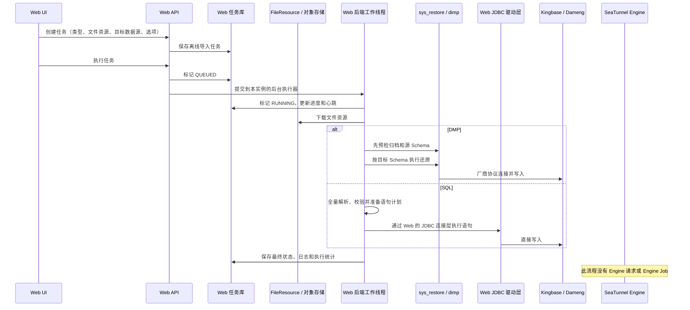

# Kingbase / Dameng DMP 与 SQL 离线导入设计：SeaTunnel Web 与 Engine 解耦

> 状态：草案，待审核  
> 范围：SeaTunnel Web 当前的 Kingbase、Dameng DMP/SQL 离线导入流程。

## 1. 设计结论

Kingbase 和 Dameng 的离线文件导入由 SeaTunnel Web 后端接收、编排并执行，整个导入过程不提交 SeaTunnel Engine Job：

- **DMP** 是厂商专有归档格式，由 Web 后端调用目标数据库厂商提供的 `sys_restore` 或 `dimp`。
- **SQL** 是可解析的脚本文件，由 Web 后端预检、按语句拆分，并通过 Web 自身的数据源 JDBC 连接执行。
- Web 将任务状态、进度和脱敏日志保存在 Web 的任务存储中；文件仍通过 Web 的 FileResource 存储引用管理。
- SeaTunnel Engine 不读取上传文件、不执行还原命令，也不需要为这项导入功能安装客户端或处理 Web 的临时文件目录。

这个边界仅适用于此处的离线导入。常规批处理或流式数据集成仍由 Web 生成 SeaTunnel 配置并提交给 Engine 执行。离线导入不属于 SeaTunnel Job，因此不产生 Engine Job ID，也不使用 Engine 的 Job 状态和指标。

## 2. 组件边界

| 组件 | 离线导入中的职责 | 不承担的职责 |
| --- | --- | --- |
| SeaTunnel Web UI | 选择导入类型、文件资源、目标数据源和 Schema；创建、执行和查看导入任务 | 不解析或执行导入文件 |
| SeaTunnel Web API | 校验任务类型和目标库类型；保存任务；接受执行请求并返回任务状态 | 不将导入任务转换成 Engine HOCON 或提交 Engine REST Job |
| Web 后端工作线程 | 从 FileResource 存储读取文件；预检并执行 SQL 或 DMP；更新任务进度、结果和日志 | 不依赖 Engine 的本地目录或插件运行时 |
| 对象存储 / FileResource | 保存上传文件，并通过 Web 的文件资源记录和对象键定位 | 不要求 Engine 挂载 Web 文件目录 |
| Kingbase / Dameng 目标库 | 接收 Web 后端发起的 JDBC 或厂商客户端连接并执行导入 | 不通过 SeaTunnel Engine 代理导入 |
| SeaTunnel Engine | 继续承载常规 SeaTunnel 作业 | 不参与 DMP/SQL 离线导入 |



## 3. 任务生命周期

离线导入通过独立的 `/api/v1/offline-import-tasks` 接口创建、查询、删除和执行任务。导入类型限定为 `KINGBASE_DMP`、`DAMENG_DMP`、`KINGBASE_SQL`、`DAMENG_SQL`，服务端会校验任务指定的目标数据源与类型对应的数据库一致。

任务元数据写入 Web 数据库。执行请求将任务置为 `QUEUED`，随后交给 `OfflineImportTaskServiceImpl` 所在 Web 实例的后台执行器；执行线程将状态推进到 `RUNNING`，并周期性写入心跳、进度和有长度上限的日志。任务最后进入 `SUCCESS` 或 `FAILED`。文件内容本身通过 FileResource 的对象键读取，不作为数据库中的任务载荷。

当前执行器是每个 Web 实例内的单线程执行器，不是 SeaTunnel Engine Worker，也不是独立部署的导入服务。Web 重启后不会恢复仍在运行的本地子进程或 JDBC 调用；过期心跳任务会被标记为失败，需重新执行。若部署多个 Web 实例，接收执行请求的实例会负责运行该任务，因此所有可能接收此类请求的实例都需具备一致的驱动、客户端、临时目录和目标库网络访问能力。

## 4. DMP 导入路径

DMP 导入不是把文件路径交给 Engine，也不是由 Engine 启动客户端。任务执行到 Web 后端后，Web 工作线程先从 FileResource 对象存储下载归档到本实例的临时目录，再由本机原生子进程读取该文件并连接目标数据库：

```text
FileResource 对象存储
    └─ Web 工作线程下载
         └─ Web 本地临时目录 / task-{任务ID}-{随机值}/
              ├─ Kingbase DMP → sys_restore → Kingbase 目标库
              └─ Dameng DMP   → dimp        → Dameng 目标库
```

临时目录由任务 ID 和随机标识组成。归档以流的形式写入磁盘，不整体载入 JVM 堆；执行流程正常收尾时（成功、失败或超时）会清理该目录。若 Web 容器被强制终止，清理代码可能来不及运行，使用持久化挂载工作目录时应设置相应的临时文件清理策略。`dimp` 需要解析自己的 `DIRECTORY` 参数，因此工作目录使用绝对路径。文件大小上限、工作目录和进程超时由 Web 后端配置控制。

### 4.1 厂商工具与命令调用

Web 根据任务类型选择一个预先配置的可执行文件路径，并通过 Java `ProcessBuilder` 以参数列表启动子进程，不经由 Shell 拼接命令。两个工具的调用方式不同：

| 文件类型 | 工具 | Web 后端的调用方式 | 目标连接 |
| --- | --- | --- | --- |
| Kingbase `.dmp` | `sys_restore` | 先运行归档列表预检；通过后运行还原命令，指定主机、端口、用户、数据库和本地 DMP 文件。按需传入源 / 目标 Schema，并关闭 owner、权限还原。 | `sys_restore` 从 Web 节点直接连接 Kingbase。密码通过子进程环境变量 `KINGBASE_PASSWORD` 传递，不放入命令行参数。 |
| Dameng `.dmp` | `dimp` | 先以 `SHOW=Y` 检查归档；通过后再运行还原命令，传入 `USERID`、DMP 文件名、日志文件、工作目录和错误处理选项。 | `dimp` 从 Web 节点直接连接 Dameng。账号、密码和目标地址按达梦工具的 `USERID=user/password@host:port` 语法传入。 |

预检先于数据还原，避免格式无效或源 Schema 不匹配时直接进入写入阶段：

- **Kingbase：**使用 `sys_restore --list` 读取归档目录，不连接目标库。用户指定源 Schema 时增加 `--schema` 和 `--strict-names`，并要求归档中有匹配条目；数据-only 归档也由工具自身的筛选结果验证。预检通过后，如目标 Schema 不存在，Web 先通过 JDBC 创建目标 Schema，再运行 `sys_restore`。还原命令按需指定 `--fromSchema` / `--targetSchema`。
- **Dameng：**使用带目标连接参数的 `dimp SHOW=Y` 检查归档，不执行对象还原。Web 按达梦工具输出的 Schema 摘要确认源 Schema 存在；输出按达梦客户端编码解码。预检通过后才运行正式 `dimp` 命令。指定不同的源、目标 Schema 时使用 `SCHEMAS` 和 `REMAP_SCHEMA=源:目标`；`IGNORE=Y/N` 对应任务的忽略错误选项。

执行期间，Web 关闭子进程标准输入，持续排空标准输出与错误输出，避免交互提示或输出缓冲阻塞工作线程。输出写入有长度上限的任务日志，并对凭据做脱敏；达到超时时间或工作线程中断时，Web 终止子进程及其子进程树。工具退出码、超时结果和任务日志由 Web 任务服务保存。

凭据传递方式因工具而异：Kingbase 密码通过 `KINGBASE_PASSWORD` 子进程环境变量传递；Dameng 的客户端语法要求密码出现在 `USERID` 参数中。应用日志会对命令和工具输出脱敏，但 Dameng 密码仍可能被具备进程检查权限的操作系统级工具看到，部署时应限制 Web 容器的进程检查和诊断访问权限。

### 4.2 内网部署需要准备什么

**DMP 导入需要厂商客户端工具，但不需要在 Web 节点安装 Kingbase 或 Dameng 数据库服务端。工具实际运行在 SeaTunnel Web 后端容器 / 主机中，因此依赖也应部署在 Web 运行环境，而非 SeaTunnel Engine 节点。**

是否要同时部署两套客户端取决于需要开放的导入类型：

| 需要支持的 DMP 导入 | Web 后端需要提供 | 环境变量 |
| --- | --- | --- |
| 仅 Kingbase DMP | 与目标 Kingbase 版本兼容的 `sys_restore` 客户端及其动态库 | `SEATUNNEL_WEB_OFFLINE_IMPORT_SYS_RESTORE_PATH` |
| 仅 Dameng DMP | 与目标 Dameng 版本兼容的 `dimp` 客户端及其动态库 | `SEATUNNEL_WEB_OFFLINE_IMPORT_DIMP_PATH` |
| Kingbase 与 Dameng DMP 均需支持 | 上述两种客户端和各自运行库都需提供 | 两个环境变量都配置 |

路径应指向 Web 容器 / 主机内真实可执行文件，例如 `/opt/native-clients/kingbase/bin/sys_restore` 和 `/opt/native-clients/dm/bin/dimp`。配置值不是宿主机对 Web 容器不可见的路径。只配置工具二进制文件通常不够；厂商包所需的动态库、库搜索路径、执行权限和临时目录权限也必须在 Web 进程环境内可用。

仓库当前后端镜像默认不包含这些厂商工具；只配置环境变量不会把二进制或动态库自动带入镜像。内网环境需将经过版本与架构验证的客户端包及其依赖纳入 Web 镜像，或将客户端目录只读挂载到 Web 容器，再用上述变量指定容器内路径。运行时无需从公网下载客户端。需要保证客户端二进制架构匹配 **Web 后端节点 / 容器**；客户端可连接不同架构的数据库服务器。若部署多个 Web 实例，每个能够接收 DMP 执行请求的实例都需要相同的客户端、动态库、路径配置、可写工作目录，以及到对象存储和目标数据库的网络路由与防火墙放行。

当前工具路径缺省为空；若路径未配置或工具启动所需依赖缺失，对应 DMP 任务会在 Web 侧失败。导入类型选项并不会根据工具路径自动隐藏，因此面向用户开放两种 DMP 类型的部署应同时配置两套工具；只部署一种时，应避免让用户选择未配置客户端的另一种类型。

客户端交付、库依赖检查和镜像布局的细节见[离线导入原生客户端镜像交付说明](../docs/offline-import-native-client-image.md)。这套依赖和目标库网络连接均由 Web 后端承担；Engine 无需安装 `dimp` / `sys_restore`、挂载 DMP 临时目录或开放相同的数据库连接权限。

## 5. SQL 导入路径

1. Web 后端从 FileResource 读取 SQL 文件；执行文件大小和可用堆内存限制后，按任务选项指定的编码解码。
2. `SqlImportPlan` 在打开目标库写入路径前拆分并预检整份脚本：检查客户端指令和管理命令，限制文件访问函数，校验 Schema 写入范围，并在配置源、目标 Schema 时改写受支持的 Schema 引用。
3. 预检通过后，Web 通过自身的数据源插件 / JDBC 连接层连接目标库，确认驱动支持语句超时；需要 COPY 数据段时，也会预先确认 Kingbase COPY API 可用。
4. Web 按语句执行并记录进度。Kingbase `COPY ... FROM STDIN` 使用 Kingbase JDBC 驱动的 Copy API；该数据段目前不对 Dameng 开放。`stopOnError` 控制普通语句遇错后是否停止，COPY 失败或连接关闭时会停止。

SQL 导入使用 Web 侧 JDBC 连接，和 Engine 的 JDBC connector / classpath 相互独立。当前连接设置为自动提交，因此这是逐语句执行，不提供整份文件的原子回滚；中途失败可能保留此前已成功的语句。Schema 处理属于安全校验和映射，不等同于跨数据库 SQL 方言转换。

## 6. Web 与 Engine 的解耦契约

离线导入路径的依赖关系如下：

- **文件契约：**任务引用 Web FileResource，工作线程通过 Web 的存储提供器读取对象；Engine 不需要共享挂载或复制 Web 的本地路径。
- **任务契约：**任务类型、文件资源 ID、目标数据源 ID、Schema 和执行选项由 Web API 与 Web 数据库存储和管理。
- **连接契约：**工作线程使用目标数据源配置，从 Web 节点直接连接 Kingbase 或 Dameng。SQL 使用 Web 的 JDBC 层，DMP 使用 Web 节点上的厂商原生工具。
- **运行时契约：**`dimp`、`sys_restore`、其动态库、JDBC 驱动和临时工作目录都属于 Web 后端运行时。它们不应通过 SeaTunnel Engine 配置下发，也不要求 Engine 节点提供。
- **作业契约：**正常 SeaTunnel 作业仍沿用 SeaTunnel 3.0.0 的 Engine 提交链路；离线导入的任务状态、超时、日志和进度由 Web 自己管理。

因此，增加或调整这类离线导入行为时，应在 Web 的离线导入服务与 `offlineimport` 组件中维护格式解析、预检和执行逻辑；只有常规数据集成任务需要使用的连接器行为，才进入 SeaTunnel Engine 的配置或插件链路。这样可以避免把厂商归档格式、原生命令行工具以及 Web 文件存储路径带入 Engine 部署。

## 7. 部署与运维约束

- Web 后端节点需要访问 FileResource 对象存储和目标数据库；DMP 导入还需要足够的本地磁盘、可写工作目录及已安装的厂商客户端运行库。
- 客户端二进制及动态库随 Web 镜像或受控挂载交付，路径通过 `SEATUNNEL_WEB_OFFLINE_IMPORT_DIMP_PATH`、`SEATUNNEL_WEB_OFFLINE_IMPORT_SYS_RESTORE_PATH` 配置。超时、文件大小限制和工作目录也通过 Web 配置管理。
- Kingbase、Dameng 连接凭据从目标数据源配置读取，不固化到镜像。DMP 执行日志会对凭据和命令输出进行脱敏；不得记录未脱敏的任务配置或还原命令。
- DMP 使用 Web 本地磁盘暂存后清理；SQL 文件在 Web 进程内存中解析，受文件大小与堆内存限制。超出 SQL 安全解析能力时应拆分脚本或使用 DMP 格式。
- Web 数据库保存离线任务结果，但 DMP 子进程和 SQL 会话运行在接收执行请求的 Web 实例内。部署横向扩展时，需保证实例间的客户端版本、配置、网络策略和运行权限一致，并为长时间导入预留 Web 节点资源。

## 8. 组件索引

- 任务 API：[OfflineImportTaskController.java](../seatunnel-web-api/src/main/java/org/apache/seatunnel/web/api/controller/OfflineImportTaskController.java)
- 任务编排与执行：[OfflineImportTaskServiceImpl.java](../seatunnel-web-api/src/main/java/org/apache/seatunnel/web/api/service/impl/OfflineImportTaskServiceImpl.java)
- DMP 命令与进程：[DmpCommandBuilder.java](../seatunnel-web-api/src/main/java/org/apache/seatunnel/web/api/offlineimport/DmpCommandBuilder.java)、[DmpProcessRunner.java](../seatunnel-web-api/src/main/java/org/apache/seatunnel/web/api/offlineimport/DmpProcessRunner.java)、[DmpArchivePreflight.java](../seatunnel-web-api/src/main/java/org/apache/seatunnel/web/api/offlineimport/DmpArchivePreflight.java)
- SQL 预检与执行：[SqlImportPlan.java](../seatunnel-web-api/src/main/java/org/apache/seatunnel/web/api/offlineimport/SqlImportPlan.java)、[SqlScriptSplitter.java](../seatunnel-web-api/src/main/java/org/apache/seatunnel/web/api/offlineimport/SqlScriptSplitter.java)、[SqlSchemaMapper.java](../seatunnel-web-api/src/main/java/org/apache/seatunnel/web/api/offlineimport/SqlSchemaMapper.java)、[SqlScriptImportRunner.java](../seatunnel-web-api/src/main/java/org/apache/seatunnel/web/api/offlineimport/SqlScriptImportRunner.java)
- 类型与选项：[OfflineImportType.java](../seatunnel-web-spi/src/main/java/org/apache/seatunnel/web/spi/enums/OfflineImportType.java)、[OfflineImportOptions.java](../seatunnel-web-spi/src/main/java/org/apache/seatunnel/web/spi/bean/dto/OfflineImportOptions.java)
- Web 运行配置：[application.yml](../seatunnel-web-api/src/main/resources/application.yml)
- 部署说明：[offline-import-native-client-image.md](../docs/offline-import-native-client-image.md)
